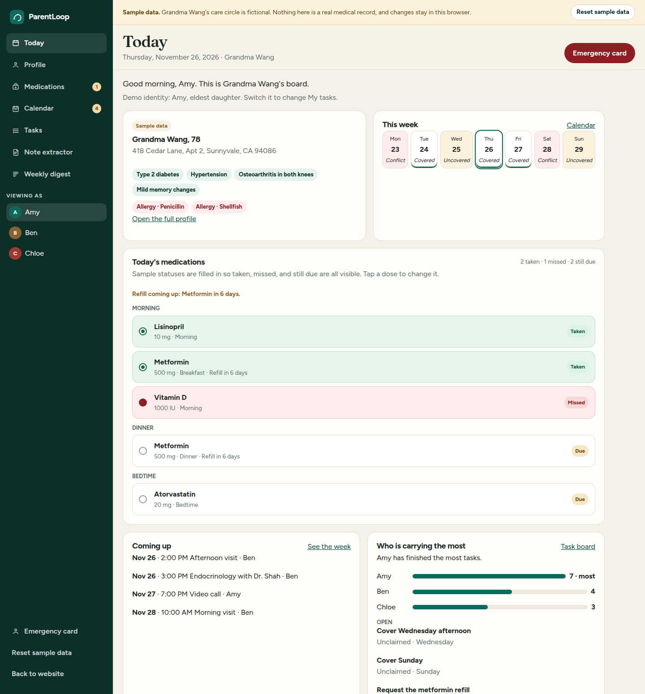

# ParentLoop

A browser demo of a family care-coordination board. Siblings share one place for an aging parent's medications, visits, and to-dos.

The site opens on a marketing page. **Open the demo** loads a sample care board for Grandma Wang, 78, and her adult children Amy, Ben, and Chloe. Sample data is labeled on the screen. Changes stay in that browser.

## Pain point

Adult children usually run a parent's care from a group chat. Dose changes, insurance numbers, and "who has Thursday" scroll away. The sibling who lives closest becomes the unpaid coordinator, and the others cannot see how much that person is carrying. A missed refill or a day with nobody scheduled shows up late, as a scramble, instead of as a task on Tuesday.

## Target users

ParentLoop is for adult children who share the care of one aging parent, especially two to four siblings who do not live in the same city. The person who feels it first is the default organizer: the daughter or son who currently keeps the medications, the rides, and the family chat straight.

## Why it's fundable now

These are the sources for this section. No other market figures are added here.

- Y Combinator's Fall 2026 Requests for Startups includes "AI for the Aging Population." A secondary summary of that request says it suggests caregiver coordination for families managing one parent's care. That caregiver-coordination detail is from the secondary summary, not from a figure quoted here: [secondary summary](https://startupideasdb.com/blog/yc-requests-for-startups-fall-2026) and the [official RFS page](https://www.ycombinator.com/rfs?batch=Fall+2026).
- 63 million US adults (about 1 in 4) are family caregivers, up 45% since 2015. 64% report high emotional stress. 24% feel alone. Source: AARP and the National Alliance for Caregiving, 2025, [Caregiving in the US](https://www.caregiving.org/wp-content/uploads/2026/02/Final-2025-CGUS-Report.pdf).
- Avanlee Care raised a $3.5 million seed in November 2026: [MedCity News](https://medcitynews.com/2026/11/startup-supporting-caregivers-raises-3-5m-in-seed-funding/).
- Abby Care raised an $82 million Series C in October 2026: [Fortune](https://fortune.com/2026/10/15/startup-abby-care-raises-82-million-to-turn-family-members-into-paid-caregivers/).
- Hera raised a $27 million Series A in June 2026 for AI senior-care coordination: [Business Wire](https://www.businesswire.com/news/home/20260625236078/en/Hera-Raises-%2427-Million-to-Manage-Senior-Care-Beyond-the-Doctors-Office).

## How to run

You do not need to install anything, and you do not need an account or an API key.

**On the web**

Open this link in Chrome, Safari, or Edge:

https://shelly6243346.github.io/parentloop/

**On your computer**

1. On this project's GitHub page, click the green **Code** button, then **Download ZIP**.
2. Unzip the folder.
3. Double-click `index.html`. It opens in your browser.
4. Click **Open the demo** to use the care board.

The sample family is already filled in: Grandma Wang, and siblings Amy, Ben, and Chloe. Anything you change is saved only in that browser. Inside the demo, **Reset sample data** puts the original example back.

The waitlist on the home page is also saved only in that browser. Nothing you type is sent to a server.

Prices on the website (Free, Family, Family Plus) are hypothetical labels for the prototype. They are not a real charge.

What you can try in the demo:

- Parent profile and a one-tap **Emergency card**
- Today's medications, with taken, missed, and still due, plus refill reminders
- A shared week for Amy, Ben, and Chloe, with conflicts and uncovered days marked
- A task board, a **My tasks** filter, and a meter for who has finished the most
- A note extractor that uses rules written for this demo (the screen says it is not a live model)
- A weekly family digest with **Copy for group chat**

## Next steps

1. Interview 10 adult-child caregivers. Look in Reddit and Facebook caregiver groups, and in Chinese diaspora WeChat groups.
2. Test $9–15 per month per family.
3. Later, a business-to-business-to-consumer path through Medicare Advantage plans and home-care agencies.
